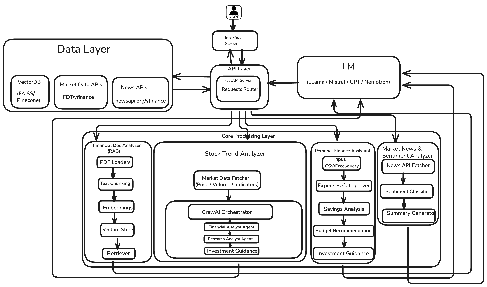
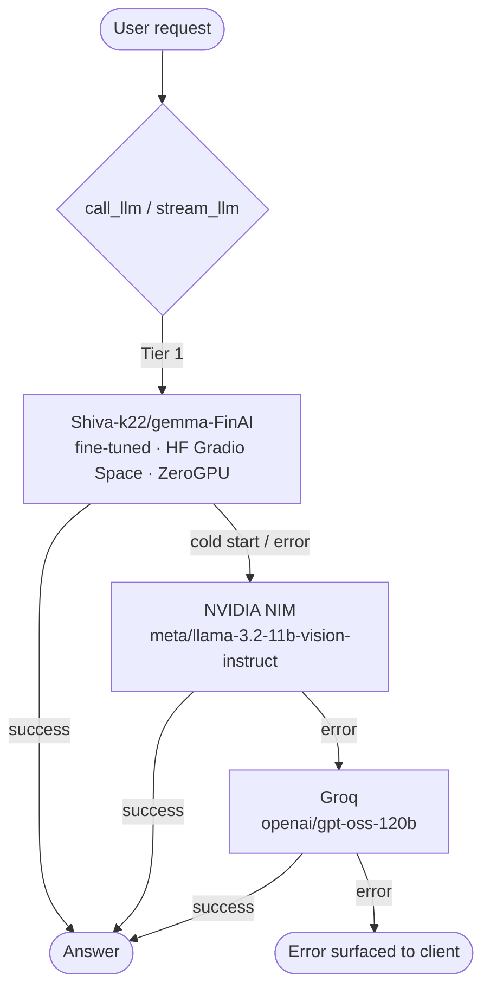
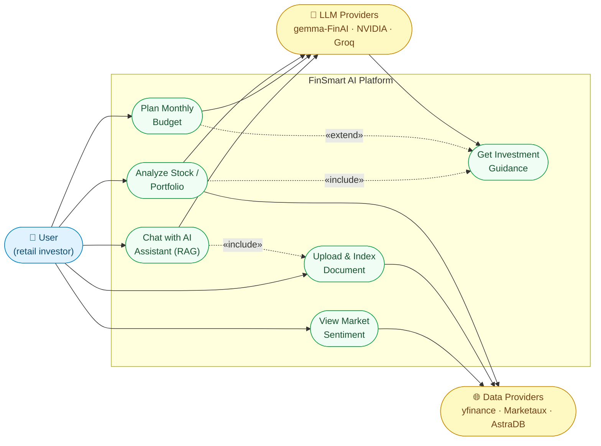

# FinSmart AI 🚀

**Your Ultimate Personal Finance & Market Intelligence Assistant**

FinSmart AI is a comprehensive, full-stack financial application combining cutting-edge AI technologies and algorithmic insights to simplify financial guidance. It empowers retail investors and everyday users by providing professional-grade market sentiment analysis, personalized budget planning, AI-driven stock analysis, and an intelligent Gen-AI Chatbot powered by Retrieval-Augmented Generation (RAG).

---

## 🏗️ Architecture Overview



*Layered architecture: Presentation & API → Core Processing (four AI engines) → LLM layer → Data layer.*

FinSmart AI follows a **layered, decoupled full-stack architecture**. A **Vite + React** single-page app talks to a modular **FastAPI** backend, which orchestrates multiple AI engines over a shared **LLM layer** and external **data providers**.

### How the system works (walking the diagram)

**1. Presentation & API Layer (top of diagram)**
- **Interface Screen** — the React SPA (dashboard pages for sentiment, chat, budget, and stocks).
- **API Layer** — the **FastAPI Server + Requests Router**. It exposes REST endpoints, validates payloads with Pydantic v2, and routes each request to the matching service in the Core Processing Layer.

**2. Core Processing Layer (middle of diagram) — four AI engines**

| Engine (as shown in diagram) | What it does | Backend code |
|---|---|---|
| **Financial Doc Analyzer (RAG)** — PDF Loaders → Text Chunking → Embeddings → Vector Store → Retriever | Ingests PDF/TXT/CSV documents, embeds and stores chunks in a vector DB, then retrieves grounded context to answer document questions. | `app/services/rag/*` |
| **Stock Trend Analyzer** — Market Data Fetcher → CrewAI Orchestrator (`Financial Analyst Agent` → `Research Analyst Agent` → `Investment Guidance`) | Fetches price/volume/indicators and runs a multi-agent **CrewAI** research desk that drafts a full investment report. | `app/services/portfolio/*`, `app/services/agents/*` |
| **Personal Finance Assistant** — Input (CSV/Excel/query) → Expenses Categorizer → Savings Analysis → Budget Recommendation → Investment Guidance | Parses natural-language income/expenses, categorizes spend, computes net savings, and recommends a budget + investment guidance. | `app/services/budget/*`, `app/services/finance_bot/*` |
| **Market News & Sentiment Analyzer** — News API Fetcher → Sentiment Classifier → Summary Generator | Fetches live financial news, scores article sentiment, and aggregates a **Market Mood / Fear-Greed** index. | `app/services/sentiment/*` |

**3. LLM Layer**
Every engine calls one shared provider abstraction (`app/core/llm_provider.py`) so model choice is decoupled from business logic. Requests are served by the first tier that responds:



**4. Data Layer**
- **Vector DB** → DataStax AstraDB (embeddings via `all-MiniLM-L6-v2`).
- **Market Data APIs** → Yahoo Finance (`yfinance`) + Financial Datasets API.
- **News APIs** → Marketaux (and `yfinance` news).

### Frontend (Vite + React SPA)
- **Framework:** React 19 powered by Vite 7 for instant HMR and optimized production builds.
- **Styling:** Custom Vanilla CSS with a premium dark-mode aesthetic, glassmorphism (translucent cards, blurred backdrops), smooth gradients, and micro-animations.
- **Data Visualization:** `Chart.js` (via `react-chartjs-2`) for dynamic Doughnut and Bar charts.
- **Routing:** `react-router-dom` v7 for seamless SPA navigation.
- **Icons:** `lucide-react` for consistent, modern iconography.
- **HTTP Client:** `axios` for API communication.
- **Markdown Rendering:** `react-markdown` + `remark-gfm` for AI-generated reports.

### Backend (FastAPI)
- **Framework:** FastAPI with Uvicorn, providing async request handling, automatic OpenAPI/Swagger docs, and Pydantic v2 validation.
- **AI/LLM Stack (3-tier provider):**
  - **Tier 1 — `Shiva-k22/gemma-FinAI`** — a fine-tuned Gemma 2B served from a Hugging Face Gradio Space (ZeroGPU); used for RAG Q&A, finance chat, budget parsing, and guidance.
  - **Tier 2 — NVIDIA NIM** `meta/llama-3.2-11b-vision-instruct` via the OpenAI-compatible NIM API (fallback).
  - **Tier 3 — Groq** `openai/gpt-oss-120b` (final fallback).
  - `CrewAI` multi-agent framework orchestrating Financial Analyst, Research Analyst, and Investment Advisor agents.
  - `LangChain` ecosystem for managing LLM interactions, retrieval chains, and prompt templates.
  - `HuggingFace sentence-transformers` for document embeddings.
  - **DataStax AstraDB** as the Vector Store for Retrieval-Augmented Generation (RAG).
- **Data Sources:** `yfinance`, Financial Datasets API, Marketaux News API, Tavily Search.

### 🎯 Use Case Diagram



**Actors**

| Actor | Type | Goal |
|---|---|---|
| **User** (retail investor) | Primary | Interact with the platform to get financial insights and guidance. |
| **LLM Providers** | Secondary | Serve model inference (`gemma-FinAI` → NVIDIA NIM → Groq). |
| **Data Providers** | Secondary | Supply market data, news, and vector storage. |

**Use cases**

| Use Case | Description | Entry point |
|---|---|---|
| **View Market Sentiment** | See aggregate market mood and Fear-Greed index. | `GET /api/sentiment/market` |
| **Chat with AI Assistant (RAG)** | Ask finance questions; includes uploading/indexing a document for grounded answers. | `POST /api/finance_rag/query` |
| **Plan Monthly Budget** | Describe income/expenses in natural language; get a categorized budget. | `POST /api/budget/analyze` |
| **Analyze Stock / Portfolio** | Run the CrewAI research desk on a ticker/portfolio. | `POST /api/portfolio/analyze` |
| **Upload & Index Document** | Ingest a PDF/TXT/CSV into the vector store. | `POST /api/rag/ingest` |
| **Get Investment Guidance** | Receive AI-driven recommendations (extended by budget/portfolio flows). | `POST /api/portfolio/recommendation` |

---

## 🌟 Core Features

### 1. 📊 Market News & Sentiment Engine
Real-time analysis of stock market news to gauge aggregate market emotion.
- Fetches top financial news articles and runs them through an LLM to derive article-level sentiment scores (-1 to 1).
- Aggregates scores into a unified "Market Mood" and calculates a real-time **Fear-Greed Index**.
- Dynamic rotating gauge via CSS transforms; responsive Chart.js bar graphs splitting positive/negative sentiment.
- **Route:** `/sentiment` · **API:** `GET /api/sentiment/market`

### 2. 🤖 AI Chatbot with RAG
A conversational financial assistant that answers complex finance questions using verified enterprise data.
- Supports general financial inquiries and targeted RAG queries based on uploaded financial documents/PDFs.
- Ingests documents → creates embeddings via `langchain-huggingface` → stores in AstraDB → uses contextual retrieval for grounded responses.
- Uses the fine-tuned `Shiva-k22/gemma-FinAI` model for document Q&A.
- **Route:** `/chat` · **API:** `POST /api/finance_rag/query`

### 3. 💰 Personal Budget Planner
Simplifies monthly accounting through Natural Language Processing (NLP).
- Users describe income and expenses in natural language; the LLM automatically categorizes expenses (Groceries, Rent, Utilities, etc.) and computes net savings.
- Interactive React pie chart detailing cash-flow breakdown.
- Features a premium, ultra-wide horizontal input interface for rapid data entry.
- **Route:** `/budget` · **API:** `POST /api/budget/analyze`

### 4. 📈 CrewAI Stock Trend Analyzer
A professional AI research desk generating comprehensive investment analysis reports.
- Input a stock ticker → CrewAI orchestrates multiple AI agents that scrape the web, pull financial data (Yahoo Finance, Financial Datasets API), compute valuation ratios, and draft professional investment recommendations.
- Multi-agent framework with Financial Analyst, Research Analyst, and Investment Advisor roles.
- Intelligently handles both public equities and unlisted private companies (via alternate data discovery).
- Markdown-rendered investment reports.
- **Route:** `/stock` · **API:** `POST /api/portfolio/analyze`

---

## 🛠️ Project Structure

```
FinsmartAI/
├── FinSmartBackend/                      # FastAPI Unified Backend
│   ├── main.py                           # App entrypoint, CORS, router registration
│   ├── requirements.txt                  # Python dependencies
│   ├── .env.example                      # Environment variable template
│   ├── test_crew.py                      # CrewAI integration smoke test
│   │
│   ├── app/                              # Core application package
│   │   ├── main.py                       # App factory (alternative entrypoint)
│   │   │
│   │   ├── core/                         # Shared infrastructure (SRP)
│   │   │   ├── config.py                 # Centralized settings (NVIDIA, AstraDB, etc.)
│   │   │   ├── llm_provider.py           # Generic LLM call wrapper (call_llm)
│   │   │   └── logging.py                # Structured logging setup
│   │   │
│   │   ├── api/                          # HTTP layer
│   │   │   ├── routers/                  # FastAPI route handlers
│   │   │   │   ├── rag_routes.py         # Document QA endpoints (uses gemma-FinAI)
│   │   │   │   ├── finance_routes.py     # Personal Finance Assistant endpoints
│   │   │   │   ├── sentiment_routes.py   # Market sentiment endpoints
│   │   │   │   ├── budget_routes.py      # Budget analysis endpoints
│   │   │   │   └── portfolio_routes.py   # Stock analysis endpoints
│   │   │   └── schemas/                  # Pydantic request/response models
│   │   │       ├── rag.py
│   │   │       ├── finance.py
│   │   │       ├── sentiment.py
│   │   │       ├── budget.py
│   │   │       ├── portfolio.py
│   │   │       └── common.py
│   │   │
│   │   └── services/                     # Business logic layer (OCP/SRP)
│   │       ├── rag/                      # RAG document intelligence
│   │       │   ├── model_factory.py      # get_qa_llm() → Shiva-k22/gemma-FinAI
│   │       │   ├── vectorstore.py        # AstraDB vector store client
│   │       │   ├── retriever.py          # Contextual document retriever
│   │       │   ├── ingest_service.py     # PDF/TXT/CSV ingestion pipeline
│   │       │   └── prompt_templates.py   # LangChain prompt templates
│   │       ├── budget/                   # Budget analysis engine
│   │       │   ├── expense_categorizer.py
│   │       │   ├── cash_flow_service.py
│   │       │   ├── savings_analyzer.py
│   │       │   └── advice_generator.py
│   │       ├── sentiment/                # Market sentiment engine
│   │       │   ├── news_engine.py        # News fetching & processing
│   │       │   ├── sentiment_analyzer.py # LLM-based sentiment scoring
│   │       │   ├── api_client.py         # Marketaux API client
│   │       │   ├── financial_datasets_client.py
│   │       │   ├── market_data_analyzer.py
│   │       │   └── config.py
│   │       ├── portfolio/                # Portfolio & stock analysis
│   │       │   ├── crew_service.py       # CrewAI orchestration
│   │       │   ├── advisor_rules.py      # Rule-based investment logic
│   │       │   └── ai_guidance.py        # AI investment guidance
│   │       ├── finance_bot/              # Personal finance assistant
│   │       │   ├── core.py
│   │       │   ├── general_qa.py
│   │       │   └── calculators.py
│   │       └── agents/                   # CrewAI agent definitions
│   │           ├── agents.py             # Financial/Research/Investment agents
│   │           ├── tasks.py              # Task definitions
│   │           └── tools.py              # Financial data tools (yfinance, APIs)
│   │
│   ├── datasets/                         # Training & reference data
│   │   ├── dataset.json
│   │   ├── final_merged_dataset.json
│   │   └── finance_finetune_data.json    # Data used to fine-tune gemma-FinAI
│   │
│   └── tests/                            # Unit & integration tests
│       ├── test_api.py
│       ├── test_budget_and_cash_flow.py
│       ├── test_finance_bot.py
│       └── test_portfolio_advisor.py
│
└── frontend/                             # Vite + React Frontend
    ├── index.html
    ├── vite.config.js
    ├── package.json
    └── src/
        ├── App.jsx                       # Router & Navbar
        ├── index.css                     # Global dark theme & design system
        ├── main.jsx                      # React entrypoint
        └── pages/
            ├── LandingPage.jsx           # Hero landing page
            ├── MarketSentiment.jsx       # Sentiment dashboard
            ├── ChatBot.jsx               # AI chatbot interface (RAG)
            ├── BudgetPlanner.jsx         # Budget analysis UI
            ├── PortfolioAdvisor.jsx      # Portfolio advisor UI
            └── StockAnalyzer.jsx         # CrewAI stock analysis UI
```

---

## ⚙️ Setup & Installation

This project requires running the **Backend API Server** and the **Frontend Dev Server** simultaneously.

### Prerequisites
- **Python 3.10+** with `pip` or `uv`
- **Node.js 18+** with `npm`
- **API Keys:** NVIDIA NIM, AstraDB, HuggingFace, Marketaux, Financial Datasets, Tavily

---

### Step 1: Configure Environment Variables

```bash
cd FinSmartBackend
cp .env.example .env
# Open .env and fill in your API keys
```

**.env keys required:**

| Variable | Description | Where to get |
|---|---|---|
| `NVIDIA_NIM_API_KEY` | NVIDIA NIM LLM (Tier 2 fallback) | [build.nvidia.com](https://build.nvidia.com) |
| `GROQ_API_KEY` | Groq LLM (Tier 3 fallback) | [console.groq.com](https://console.groq.com/keys) |
| `HF_TOKEN` | HuggingFace token (for gemma-FinAI & embeddings) | [huggingface.co/settings/tokens](https://huggingface.co/settings/tokens) |
| `GEMMA_FINAI_SPACE_URL` | Runtime host of the gemma-FinAI Gradio Space (Tier 1) | Default: `https://shiva-k22-gemma-finai-demo.hf.space` |
| `GEMMA_FINAI_SPACE_FN` | Gradio API function name exposed by the Space | Default: `/bot_reply` |
| `ASTRA_DB_API_ENDPOINT` | AstraDB endpoint | [astra.datastax.com](https://astra.datastax.com) |
| `ASTRA_DB_APPLICATION_TOKEN` | AstraDB token | [astra.datastax.com](https://astra.datastax.com) |
| `MARKETAUX_API_KEY` | News & sentiment | [marketaux.com](https://www.marketaux.com) |
| `FINANCIAL_DATASETS_API_KEY` | Financial datasets | [financialdatasets.ai](https://financialdatasets.ai) |
| `TAVILY_API_KEY` | Web search for CrewAI | [tavily.com](https://tavily.com) |
| `QA_HF_MODEL` | Fine-tuned QA model (optional override) | Default: `Shiva-k22/gemma-FinAI` |

> 💡 `GEMMA_FINAI_SPACE_URL` must be the Space **runtime** host (`…hf.space`). If you supply the web page URL (`huggingface.co/spaces/owner/name`), the backend converts it automatically.

---

### Step 2: Start the FastAPI Backend

```bash
cd FinSmartBackend

# Option A — using uv (recommended)
uv venv
source .venv/bin/activate
uv pip install -r requirements.txt

# Option B — using pip
python3 -m venv venv
source venv/bin/activate
pip install -r requirements.txt

# Start the API server (http://localhost:8000)
uvicorn main:app --reload --host 0.0.0.0 --port 8000
```

> 📖 Visit `http://localhost:8000/docs` for interactive Swagger API documentation.

---

### Step 3: Start the React Frontend

```bash
cd frontend

# Install dependencies (first time only)
npm install

# Start the Vite dev server (http://localhost:5173)
npm run dev
```

---

## 📝 Tech Stack

| Layer | Technology |
|---|---|
| **Frontend** | React 19, Vite 7, Chart.js, react-chartjs-2, react-markdown, Lucide Icons, Vanilla CSS |
| **Backend** | FastAPI, Uvicorn, Pydantic v2, python-dotenv |
| **AI / LLM** | `Shiva-k22/gemma-FinAI` (fine-tuned, Tier 1) → NVIDIA NIM `llama-3.2-11b` (Tier 2) → Groq `gpt-oss-120b` (Tier 3); CrewAI multi-agent, LangChain |
| **Embeddings** | HuggingFace sentence-transformers (`all-MiniLM-L6-v2`), PyTorch |
| **Vector DB** | DataStax AstraDB |
| **Data Sources** | yfinance, Financial Datasets API, Marketaux News API, Tavily Search |
| **HTTP** | Axios (frontend), httpx / requests (backend) |

---

## 🚀 API Endpoints

| Endpoint | Method | Description |
|---|---|---|
| `/` | GET | Root health check |
| `/health` | GET | Service health status |
| `/api/rag/ingest` | POST | Upload & index a financial document |
| `/api/rag/query` | POST | Q&A over document (fine-tuned gemma-FinAI) |
| `/api/rag/query/stream` | POST | Streaming SSE Q&A over document |
| `/api/finance_rag/query` | POST | Personal finance assistant chatbot |
| `/api/sentiment/market` | GET | Fetch real-time market sentiment |
| `/api/budget/analyze` | POST | Analyze budget from natural language |
| `/api/budget/cash-flow` | POST | Compute cash flow breakdown |
| `/api/portfolio/analyze` | POST | Run CrewAI stock trend analysis |
| `/api/portfolio/recommendation` | POST | AI-driven portfolio recommendation |

> Full interactive docs available at `http://localhost:8000/docs`

---

## 📄 License

MIT
